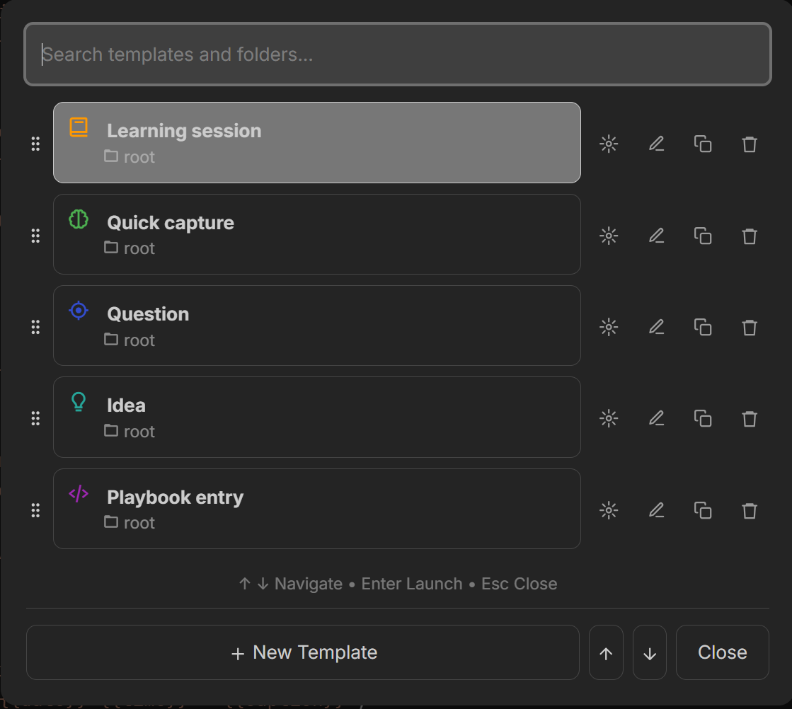
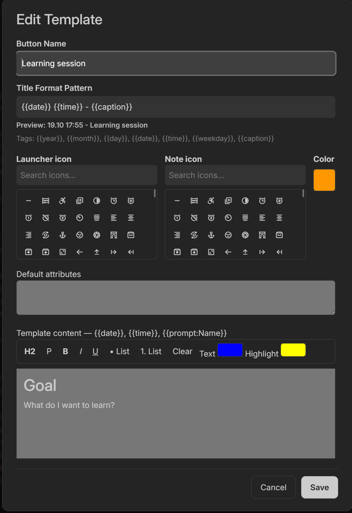
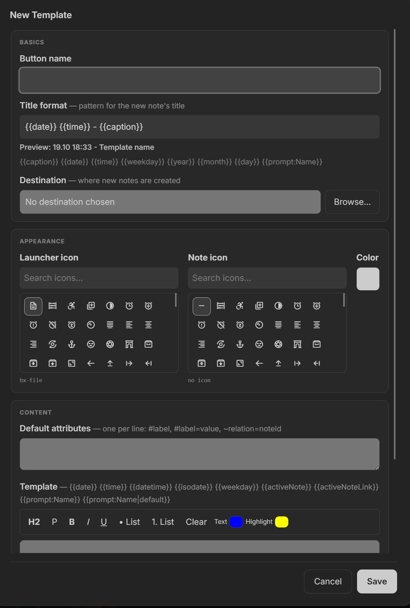
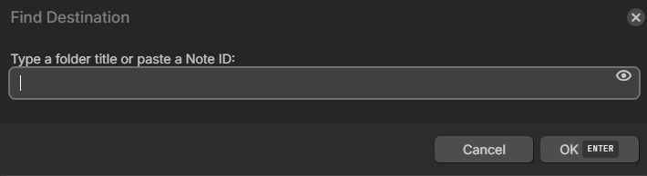
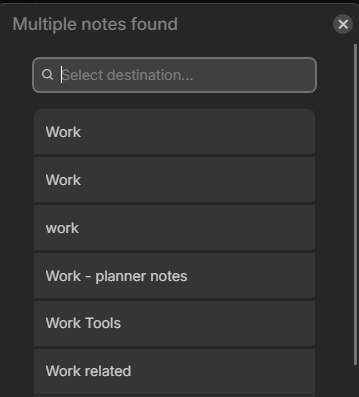
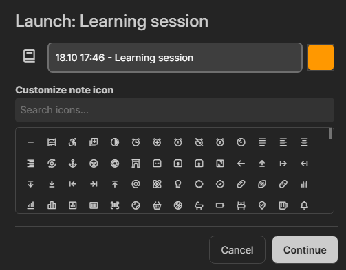
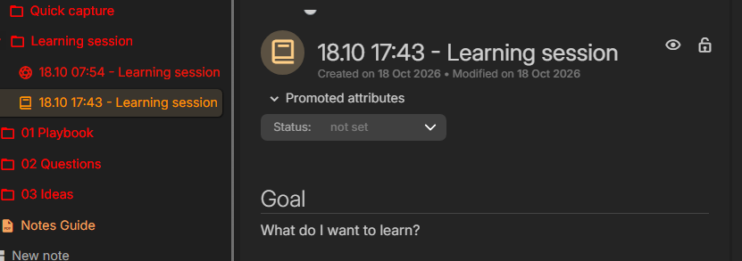
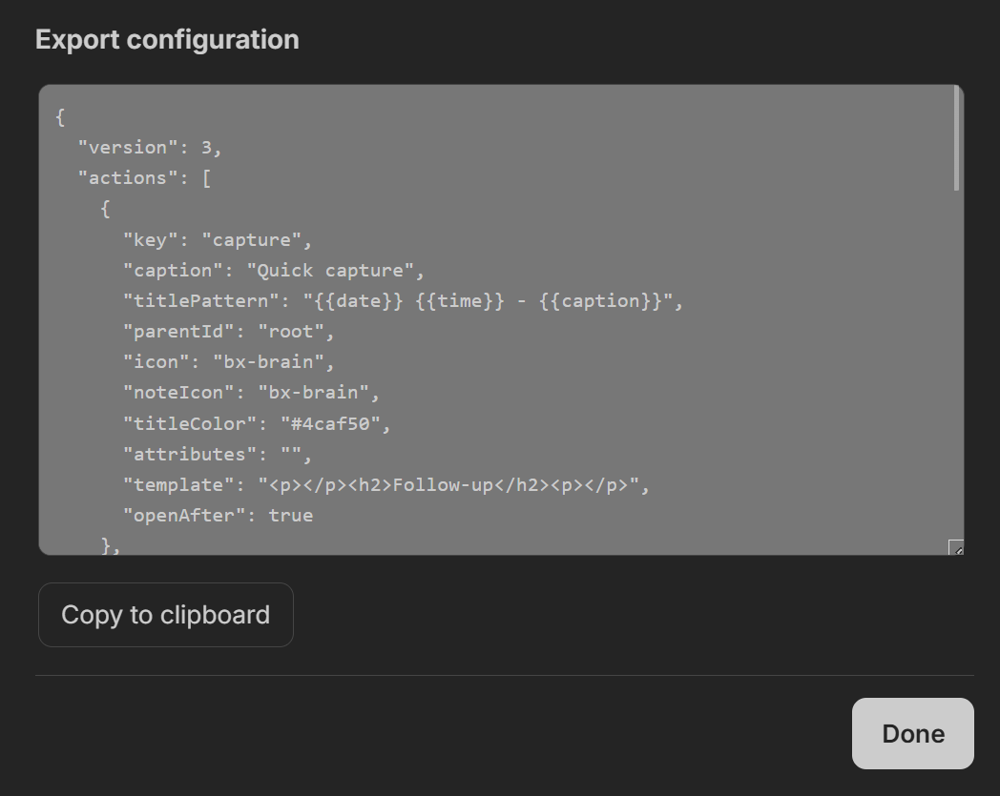
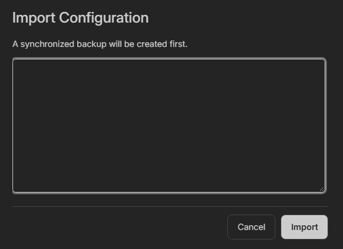
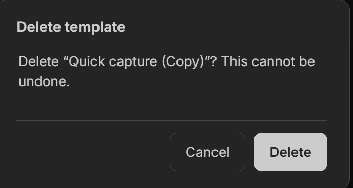

# Trilium Session Launcher

A quick-launch menu and template manager for [Trilium Notes](https://github.com/TriliumNext/Trilium).
It provides a front-end overlay to rapidly create formatted notes, journal entries, and templates in targeted folders directly from a single unified popup dialog.

## Features

- **Unified Launch Dialog:** Input variables, tweak note titles, change icons, and add extra on-the-fly notes within a single, streamlined window.
- **Live Destination Picker:** Find target folders instantly using a fuzzy-search popup, or paste a Note ID directly.
- **Active Note Targeting:** Set a template's destination to `@active` to automatically create the new note as a child of the note you are currently viewing.
- **Dynamic Variables & Defaults:** Inject `{{date}}`, `{{time}}`, `{{activeNote}}`, `{{activeNoteLink}}`, or custom prompts with fallback defaults like `{{prompt:Project Name|Untitled}}`.
- **Custom Title Patterns:** Define automated title structures for each template (e.g., `{{date}} - {{caption}}`) with live previews in the editor.
- **Rich Text Template Editor:** Built-in editor supporting custom headers, lists, bolding, colors, and background highlights.
- **Colored Launcher Buttons:** Main menu buttons automatically inherit your template's assigned color for rapid visual muscle-memory.
- **Mobile-Friendly Reordering:** Easily rearrange your templates using dedicated Up/Down arrow buttons optimized for phone screens, alongside the standard drag-and-drop grip for desktop users.
- **State Preservation:** The menu remembers your scroll position and search queries when returning from the editor or launch screens.
- **Native Boxicon Picker:** Access Trilium's built-in Boxicons natively without external dependencies.
- **Automated Sync & Backups:** Configuration auto-saves to `_Session Launcher Config_`. Importing new configurations creates a timestamped backup automatically.

## Installation

1. Open your Trilium workspace.
2. Create a new Note and set the title to `Session Launcher`.
3. Set the Note Type to **JS Frontend**.
4. Paste the contents of `session-launcher.js` into the note editor.
5. Add the label attribute `#run=front` to the note.

*Tip: Assign a keybinding to this note in Trilium's shortcut settings, or add it to your launcher bar for single-click access.*

## Usage & Controls

| Action | Control / UI Element |
| :--- | :--- |
| **Navigate List** | `↑` / `↓` Arrow keys |
| **Launch Selected** | `Enter` key or click item row |
| **Quick Launch** | `Alt` + `1-9` number keys |
| **Close Menu** | `Esc` key or **Close** button |
| **Reorder Item** | **Up/Down arrows**, left grip handle (`:::`), or `Alt` + `↑` / `↓` |
| **Edit Item** | Pencil icon (`✏️`) |
| **Change Folder** | Gear icon (`⚙️`) |
| **Duplicate Item** | Copy icon (`📋`) |
| **Delete Item** | Trash icon (`🗑️`) |
| **Export Config** | **↑** button at bottom right |
| **Import Config** | **↓** button at bottom right |

---

## Screenshots

### 1. Main Menu
The primary quick-launch overlay listing active templates and destination folders.

### 2. Template Creation & Editing
Customize template buttons, icons, default attributes, and rich text content.

#### Edit Template

#### New Template

### 3. Destination Selection
Search and assign target folder destinations by folder title or Note ID.

#### Find Destination Input

#### Search Results

### 4. Launch & Note Creation
Review titles, substitute dynamic variables, and generate formatted notes directly in your workspace.

#### Launch Confirmation

#### Formatted Generated Note

### 5. Backup & Configuration Management
Safely export or import JSON configurations with automated backup creation.

#### Export Configuration

#### Import Configuration

#### Delete Confirmation

---

## License

[MIT License](LICENSE.txt)
